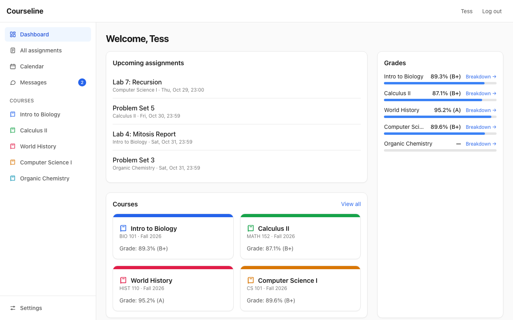
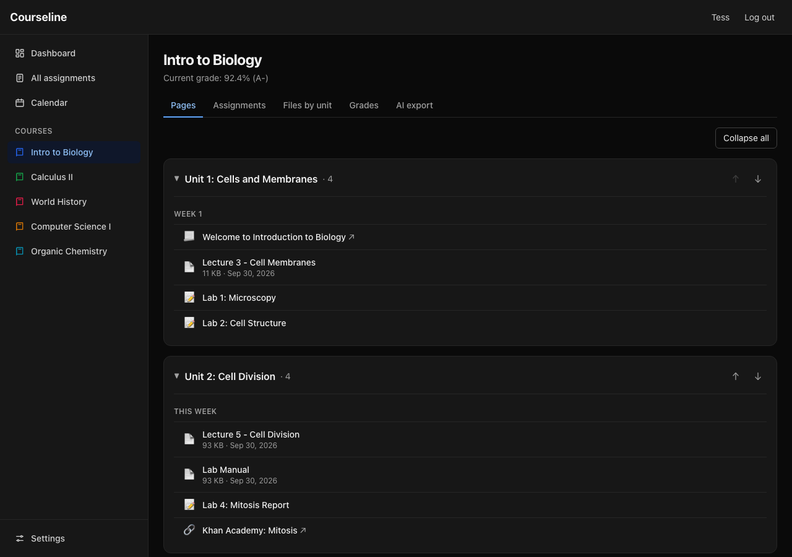
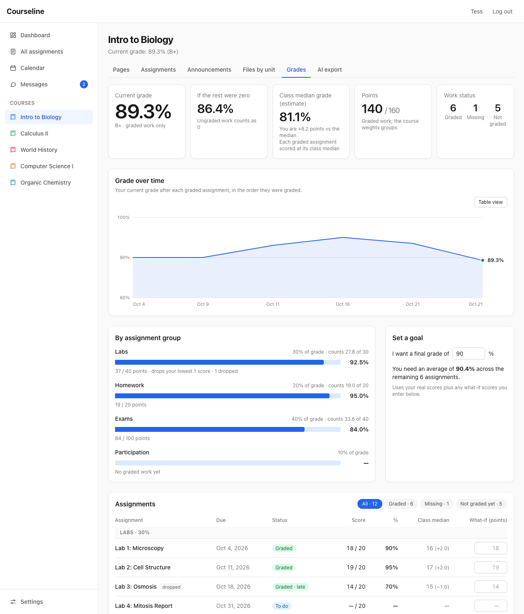
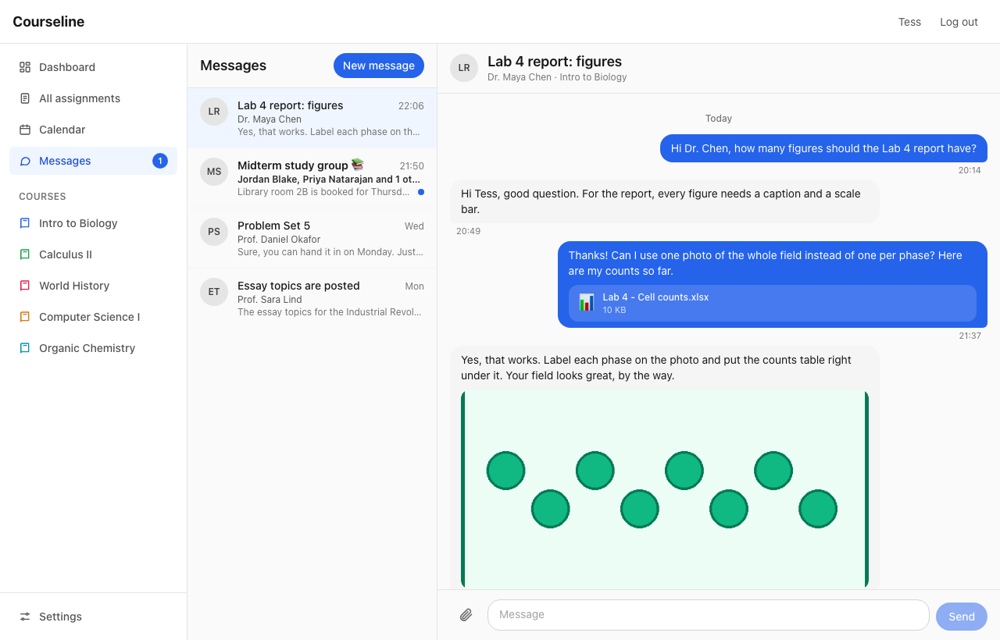
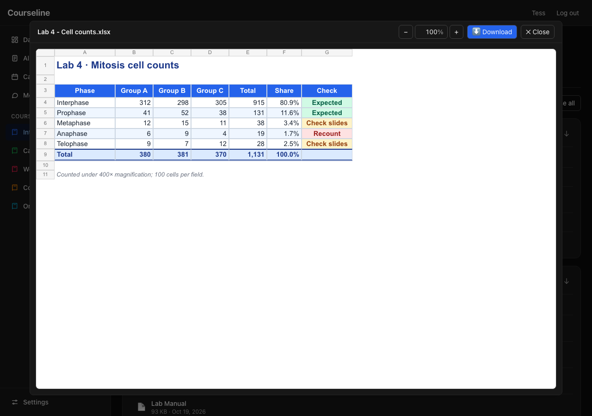
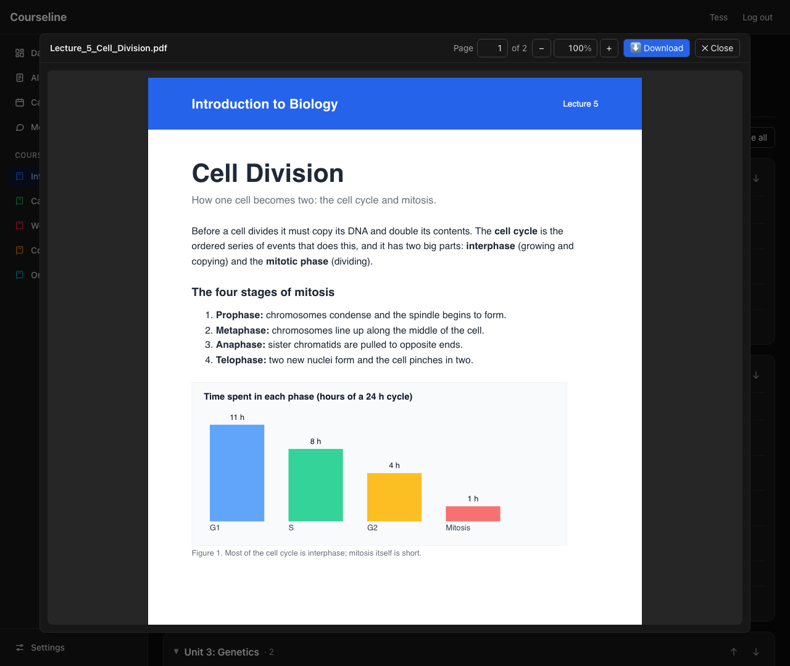
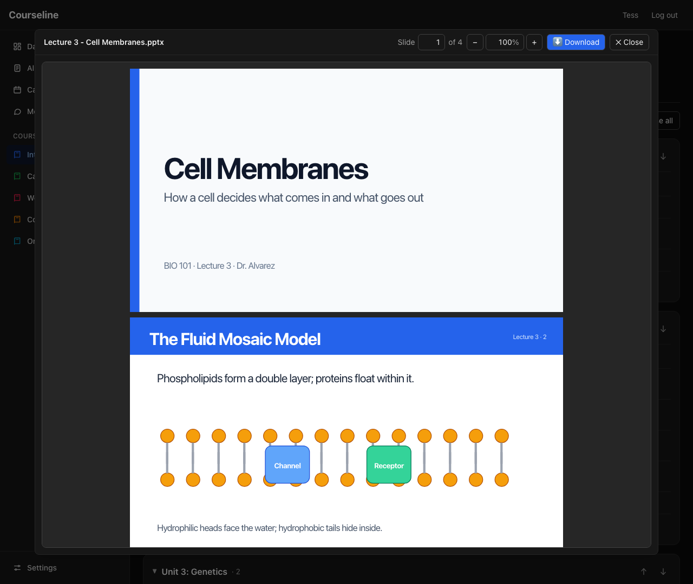
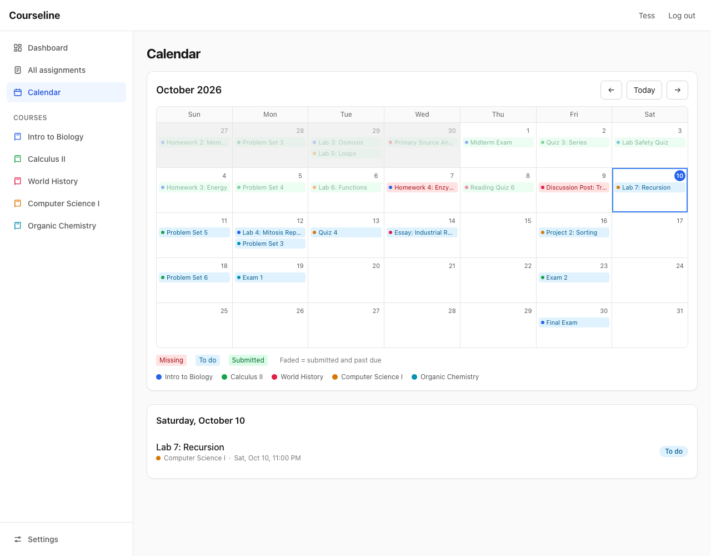

# Courseline

A faster, cleaner web client for [Canvas LMS](https://www.instructure.com/canvas). It runs entirely in your browser and
talks directly to your school's Canvas API with a personal access token. There is no server of its own.

React · TypeScript · Vite · Tailwind CSS 4

**Two editions, one codebase.** The `main` branch is the **API-token edition**: sign-in by access token only, and
the app never looks for or talks to the browser extension. The `dev` branch is the full app, with the extension as a
second way in. Both have every other feature. They differ only in [`edition.json`](edition.json) (`"apiOnly": true`
on `main`, `false` on `dev`) and in the `extension/` folder, which `main` does not have. Merging `dev` into `main` keeps
`main` API-only as long as `edition.json` is never changed on `dev` (see
[Branches and editions](DEVELOPER_GUIDE.md#branches-and-editions) for the merge). Any build can be made API-only with
`COURSELINE_EDITION=api`.



## What it does

- **Course pages and modules in one list.** Collapsible, reorderable, remembered per course, so a course looks the same
  whether the teacher built it from Pages or from Modules.
- **In-app file viewer.** PDF, Word, Excel, PowerPoint, images and code open in a viewer with page numbers, typed zoom
  and an explicit Download button. Nothing downloads unless you press that button. Excel files (.xlsx) keep their
  cell colours, fonts, borders, column widths and merged cells, on a white page even in dark mode; .xls, .ods and .csv
  show their values only.
- **In-depth grades page.** Grade over time, assignment-group breakdown with weights and drop rules, what-if scores,
  a "what do I need to reach X%" calculator, and an estimate of the class median grade (from each assignment's class
  median, when Canvas shares it).
- **Messages that feel like texting.** Your Canvas Inbox and sent messages as conversations, each a thread of
  bubbles with its subject on top as the chat name; reply with Enter, attach files (images and files preview inline),
  or start a new message to a course's teachers and classmates. The sidebar shows how many conversations are unread;
  with a token, opening one marks it read. Works with a
  token and, on `dev`, with the extension.
- **Calendar and All assignments** across your chosen courses, colored by course and by status (missing, to do,
  handed in).
- **Dark mode and a custom accent color**, your own color and icon per course, and a setting to pick which courses to
  show.
- **AI export tab in every course**: packs the syllabus, units, pages, assignments and file text into a zip an AI can use as a tutor (stays on your computer).
- **No access token needed, optionally.** A Chrome-based browser extension (in `extension/`) saves the data your own
  Canvas pages load, and Courseline reads it, with a live preview, per-course freshness and one-click refresh of any
  page. See [Use it without a token](#use-it-without-a-token). Not in the API-token edition (`main`).
- **Times follow your computer**: 12- or 24-hour clock and the first day of the week (on a Mac, read from System
  Settings by the dev server, since browsers don't pass that on).
- **English, Spanish and Brazilian Portuguese**, switchable in Settings (defaults to your browser's language).

## Screenshots

Screenshots use made-up course data, signed in with a token, so they look the same on `main` and `dev`.

| Course pages and modules in one view | Grades: trend, groups, class median, what-if |
|---|---|
|  |  |
| **Messages: conversations as chats, with attachments** | **Spreadsheet viewer: the file's own colours and borders** |
|  |  |
| **PDF viewer** | **PowerPoint viewer** |
|  |  |
| **Calendar, colored by course and status** | |
|  | |

Developer documentation (architecture, every file, how to change anything, known gaps):
**[DEVELOPER_GUIDE.md](DEVELOPER_GUIDE.md)**.

## Use it without a token

> **`dev` branch only.** The API-token edition on `main` has no extension support; check out `dev` to use this.

Canvas is making access tokens harder to get, so Courseline can also work from the browser extension in `extension/`.
It works in Chrome, Arc, Edge, Brave and other Chromium browsers.

1. Open `chrome://extensions` (in Arc: the same address), turn on **Developer mode**, choose **Load unpacked**, and
   pick the `extension/` folder of this project. Reload Courseline if it was already open.
2. Start the app (`npm run dev`) and open <http://localhost:5173>.
3. On the login page, type your Canvas address and press **Connect and load my courses**. A panel at the bottom right
   shows your Canvas pages loading, a few at a time, in background tabs; you are signed in as soon as data arrives.
4. **Settings → Connection** has the whole setup: the extension, your Canvas address, Sync now, pulling any single page,
   and everything that was captured. The sidebar's **Extension** item, under your courses, says how current the data is
   and has Sync now and a refresh for each kind of data.

What it can and cannot do: it shows courses, assignments, grades (worked out from the scores it saw), units, pages,
announcements, discussions and the syllabus. Some of that Canvas builds into the page instead of loading it (the Grades
page, the course home page, the syllabus), and the extension reads it from the page too. **Messages** work too: when you open
Messages in Courseline, the extension reads your inbox, your sent folder and their threads from a Canvas tab it opens in
the background (read-only, nothing is marked read, at most every two minutes; visiting Canvas's own Inbox adds to it),
and when you press Send it sends the message, with any attachments, from such a tab too (only after your click, only to
your Canvas). Opening files, submitting work and
replying to assignment feedback need a token (those buttons say so and send you to Canvas). **If your school hides a course tab
in Canvas** (some courses only show Home, Announcements, Grades and People), no Canvas page ever loads that data, so the
extension cannot see it: Courseline says it is not in this course's Canvas menu there, and a token shows it. The Grades page still gives
those courses their assignments and grade. It only reads what your own Canvas pages load, only from the address you saved, and keeps
it on your computer. Read the security notes in [DEVELOPER_GUIDE.md](DEVELOPER_GUIDE.md#9-security-model) before
sharing it with anyone.

## Run it

Requires **Node 22.13 or newer** (22 LTS recommended). Node 20 can run the app with an `EBADENGINE` warning (the PDF
library declares `>=22.13`), but cannot run the tests (Vitest 5 needs 22.12+).

```bash
npm install
cp .env.example .env      # then edit it (see below)
npm run dev               # prints the address, usually http://localhost:5173
```

**Or just double-click `start-courseline.command`** (macOS; or run `./start-courseline.command`). It finds a Node 22.13+
on its own, starts the server on <http://localhost:5173> (it does not open a tab; add `OPEN=1` if you want it to); run it
again and it says it is already running. Stop it with Ctrl-C. It uses port 5173 only,
or the one you give with `PORT=5174` (on `dev` the browser extension talks to 5173-5180 and 4173), so it stops with a
message if something else has that port, rather than moving to another one.

If you start it with `npm run dev` and port 5173 is busy, Vite moves to the next one and prints it. Use the address it prints.

Needs a current browser (Chrome/Edge 111+, Safari 16.4+, Firefox 128+; Word/PowerPoint zoom needs Firefox 126+),
because Tailwind 4 uses modern CSS.

| Command | What it does |
|---|---|
| `start-courseline.command` | Starts the dev server (double-click it); `OPEN=1` also opens a tab |
| `npm run dev` | Dev server |
| `npm test` | Unit and component tests (Vitest) |
| `npm run typecheck` | TypeScript check (strict) |
| `npm run build` | Typecheck, then a production bundle in `dist/` |
| `npm run preview` | Serves the built `dist/` locally |
| `npm run test:watch` | Tests, re-run on every save |
| `npm run e2e` | (`dev` only) A real Chrome with the extension, a mock Canvas and the running app: start `npm run dev` first; set `CHROME_PATH` if Chrome is not in `/Applications` |

### Environment (`.env`)

| Variable | Meaning |
|---|---|
| `VITE_CANVAS_BASE_URL` | Your school's Canvas address, e.g. `https://myschool.instructure.com`. Pre-fills the login form and is the dev proxy's target. |
| `VITE_CANVAS_API_TOKEN` | Optional. Skips the login screen. Leave it empty unless you understand the security note below. |
| `VITE_USE_DEV_PROXY` | `true` sends all Canvas calls through the Vite dev server. Needed if your school blocks browser requests (CORS), and **required for file previews at schools that do**. Restart `npm run dev` after changing it. |
| `COURSELINE_EDITION` | `api` makes this build the API-token edition (token sign-in only; the app ignores the extension), even on `dev`. Also works from the shell, e.g. `COURSELINE_EDITION=api npm run build`. Tests ignore it. |

### Get a Canvas API token

1. Log in to your school's Canvas in a browser.
2. **Account** (left rail) → **Settings**.
3. Scroll to **Approved Integrations** → **+ New Access Token**.
4. Give it a purpose ("Courseline") and an expiry date (set one), then **Generate Token**.
5. **Copy it immediately.** Canvas never shows it again.

Paste it into the app's login screen together with your school's address (what you see in the address bar when logged
in to Canvas).

> Some schools disable personal access tokens. If "+ New Access Token" is missing, ask your Canvas admin.

## Security

- The token is stored in the browser's **localStorage**. Any script on the page (an XSS bug, a compromised npm package)
  can read it, and the token has **your full Canvas access**.
- `VITE_*` variables are **inlined into the built JavaScript**. Never build and publish with a real token in `.env`.
- This is meant for personal use on your own computer. Before anyone else uses it, move the token behind a small
  backend or use Canvas OAuth2 (needs a developer key from your Canvas admin).
- Each person uses their **own** token. Revoke tokens you no longer need (Settings → Approved Integrations).
- Never commit `.env`. It is in `.gitignore`.
- The token is only ever sent to the Canvas address you entered, over https (an `http://` address is upgraded), and
  never to file storage or any other host. Instructor HTML is sanitized before display; spreadsheet cells and
  messages are shown as plain text (links only when they are http or https).
- (`dev` only) The browser extension keeps nothing until you save your Canvas address, never saves credentials, email addresses
  or capability links, and only takes commands from the Courseline app running on `localhost`. It sends a message only
  after a click on Send in Courseline, and reads your messages only when you open Messages there. The full list of known
  risks is in [DEVELOPER_GUIDE.md §9](DEVELOPER_GUIDE.md#9-security-model).

## Status

In day-to-day use by the author on real school courses. Covered by automated tests: the API client (pagination, error
mapping, downloads, file upload), grade calculation, HTML sanitizing, the data cache, accent colors, the submission
form, messages, spreadsheet formatting, the system clock, the API-token edition's sign-in, the app's extension mode (on both branches), the browser extension's own logic (on `dev`, where `extension/` is), and a smoke test that renders every screen except Messages against a fake Canvas. On `dev`, `npm run e2e` also drives the extension in a real Chrome against a mock Canvas. The screens and the file viewer were also checked in a real browser, in light and dark mode and at phone width.

Canvas installations differ a little between schools. If you use this at a new school, try a submission on a throwaway
assignment first. If your school's file storage refuses browser uploads, the app says so and points you to "Submit in
Canvas". See [DEVELOPER_GUIDE.md § Known gaps](DEVELOPER_GUIDE.md#13-known-gaps-and-ideas).

## Canvas API notes

| Topic | What to know |
|---|---|
| Auth | `Authorization: Bearer <token>` header on every request. |
| Base path | `https://<school>/api/v1/...` |
| Pagination | Defaults to **10 items/page**. Pass `per_page=100` (the max). The next page URL is in the **`Link` response header** (`rel="next"`) and is opaque: follow it verbatim. `getAll()` in `src/api/client.ts` does this. |
| Array params | Need brackets: `include[]=submission&include[]=total_scores`. |
| Rate limits | Leaky bucket (~700 units, refills continuously). Remaining quota is in `X-Rate-Limit-Remaining`. Exceeding it returns **403** (not 429) with "Rate Limit Exceeded" in the body. Avoid one request per course; prefer aggregate endpoints. |
| Grades | `include[]=total_scores` on `/courses` returns `computed_current_score` / `computed_current_grade` on the enrollment. `null` means hidden or ungraded, not 0. |
| Restricted courses | Past/future-term courses can come back with no `name` and `access_restricted_by_date: true`. They are filtered out. |
| Dates | ISO 8601 UTC strings. `due_at` can be `null`. Per-student overrides aren't reflected in the base `due_at`. |
| IDs | Numbers, but may exceed 2^53 on some shards. Send `Accept: application/json+canvas-string-ids` if that bites. |
| CORS | Canvas generally allows browser calls with a Bearer token, but some institutions block it. If you see a network/CORS error, set `VITE_USE_DEV_PROXY=true` and restart `npm run dev`. |

Official docs: <https://canvas.instructure.com/doc/api/>. More quirks, and why the code handles them the way it does, are
in [DEVELOPER_GUIDE.md § Canvas quirks](DEVELOPER_GUIDE.md#8-canvas-quirks-reference).

## License

[PolyForm Noncommercial 1.0.0](LICENSE). In plain words:

- **You can** use it, change it and share it (with the license attached) for **personal and other noncommercial use**:
  your own coursework, hobby projects, learning, and use by schools and non-profits.
- **You cannot** sell it, sell a changed version of it, or use it to make money.
- **Commercial use is reserved to the copyright holder.** To license it commercially, contact the author.

This is a "source-available" license, not an OSI-approved open-source license. The code is public, but it is not
free for commercial use.

## Contributing

```bash
npm run typecheck && npm test && npm run build
```

All three must pass (CI runs them on every push to `main` and on every pull request; pushes to `dev` are not checked). Read
[DEVELOPER_GUIDE.md § Conventions](DEVELOPER_GUIDE.md#12-conventions) first.
